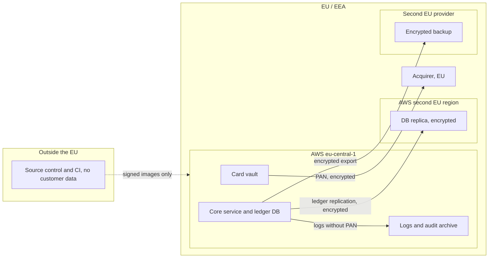

# Controls: residency, DORA, PCI DSS, GDPR

**This is not legal advice.** It is an engineering assessment to support your DPO, legal counsel, compliance function and auditors.
**These are control requirements for the design, not evidence of compliance; evidence comes from the built system.** Frameworks certify the organisation, not the diagram.

## 1. Jurisdictions, residency level, regions
- Jurisdiction: EU/EEA (Germany primary). Supervisor: BaFin (and Deutsche Bundesbank).
- Residency level: **R1, in-region**, with customer-managed keys as an added control (assumption: the CTO accepts a US-parented hyperscaler with mitigations). If R3 is required, use option C.
- Regions: primary AWS eu-central-1 (Frankfurt); disaster recovery in a second EU region (eu-west-1 or eu-west-3, to be chosen); backup copy at a second EU-headquartered provider. A region-restriction policy at the organisation level denies every region outside the EU.

| Data category | Region |
|---|---|
| Cardholder data (PAN) | Frankfurt (CDE account); DR replica in the second EU region, encrypted |
| Ledger and payment records | Frankfurt; DR replica; encrypted backup copy at the second provider |
| Merchant and staff profiles | Frankfurt (identity service in eu-central-1, verify) |
| Fraud features and decisions | Frankfurt |
| Logs and audit trail | Frankfurt, immutable archive in the security account |
| Analytics and model training | Frankfurt, pseudonymised exports |

## 2. Data-flow map
| Data category | Regulated? | Stored in | Processed by | Sub-processors | Leaves the jurisdiction? |
|---|---|---|---|---|---|
| Card data (PAN, expiry) | PCI DSS, GDPR | AWS eu-central-1, CDE account | Card vault | AWS; acquirer (as controller or processor, contract-dependent) | No |
| Ledger, payments | GDPR, financial record-keeping | AWS eu-central-1 and DR region | Core service, worker | AWS | No |
| Merchant/staff profile | GDPR | AWS eu-central-1 | Dashboard, identity service | AWS | No |
| Fraud features | GDPR (profiling, Art. 22 review) | AWS eu-central-1 | Fraud module | AWS | No |
| Logs, telemetry | GDPR (may contain personal data) | AWS eu-central-1, archive bucket | Observability | AWS | No, provided the log pipeline stays in-region; no US SaaS APM |
| Backups | same as source | AWS EU regions and second EU provider | Backup jobs | AWS; second provider | No |
| Source code, CI logs | Not customer data | GitHub (US) | CI | GitHub | Yes, but contains no customer data; a rule forbids test data from production (see CR-12) |
| 3-D Secure data | PSD2, GDPR | 3DS provider (EU-based provider required, to select) | 3DS provider | to select | Must be No: contract requirement |

## 3. Jurisdiction flags
| Component | Provider | Region | Rating | Mitigation |
|---|---|---|---|---|
| All compute, data, keys | AWS | eu-central-1, second EU region | 🟡 In-region, foreign parent | Customer-managed keys, EU-only region policy, encryption before export, EU contractual terms (verify AWS European Sovereign Cloud as a later option, not assumed) |
| Cognito identity | AWS | eu-central-1 | 🟡 | same; check no replication outside the region (verify) |
| Second-provider backup | EU-headquartered provider | EU | 🟢 Local | Client-side encryption, keys held by us |
| Source control, CI | GitHub (Microsoft) | US / global | 🔴 Leaves (no customer data) | Never put production data or secrets in CI; short-lived federated credentials; DORA register entry |
| 3-D Secure server | to select | EU required | to rate | choose an EU provider |
| Alerting / on-call SaaS | to select | EU if possible | to rate | send metadata only, never PAN or personal data |
| Support access by cloud provider | AWS | global staff | 🟡 | Remote access from outside the EU counts as a transfer under GDPR (verify), so use customer-managed keys and restrict support case contents |

## 4. Provider comparison
| | AWS Frankfurt (B) | EU-headquartered, e.g. STACKIT (C) |
|---|---|---|
| Residency level | R1 plus keys | R1, and R3 candidate |
| Foreign-parent exposure | Yes (mitigated, not removed) | None for the provider (verify) |
| Managed services needed | All present (verify per region) | Gaps: payment key service, managed identity, possibly synchronous-replication semantics (verify) |
| Portability | Mostly Adaptable; key service Locked | Mostly Portable |
| Team-fit | 4 of 4, Within | 4 of 4, Within by script; I rate it the least comfortable (Kubernetes 1) |
| Certifications (PCI DSS, ISO 27001, C5) | Available (verify scope) | Verify |
Never claim a sovereign or EU provider removes every legal question; the legal assessment is yours.

## 5. Laws and frameworks (inferred)
**Likely applicable:** DORA (we are a financial entity; ICT risk, incident reporting, third-party register, resilience testing, exit strategies), GDPR, PCI DSS v4.0.x (service provider), PSD2 and the German ZAG (strong customer authentication, safeguarding, payment-institution authorisation), BaFin supervision (which, after DORA, relies on DORA plus BaFin circulars on ICT and outsourcing; verify the current ones), anti-money-laundering rules (GwG), ISO 27001 (customer procurement).
**Possibly applicable:** NIS2 (DORA normally takes precedence for financial entities; verify), card-scheme rules from the acquirer (scheme security requirements, e.g. PIN/PCI P2PE if terminals are ever added).

| ID | Control requirement | Law / framework | Design element |
|---|---|---|---|
| CR-01 | Customer data (all categories in section 2) stored and processed only in EU regions; non-EU regions denied by organisation policy | GDPR, requirement | ADR-0001 |
| CR-02 | PAN stored only in the CDE account, encrypted with keys in the key service; PAN never in logs, queues or the ledger | PCI DSS | ADR-0004 |
| CR-03 | CDE segmented: no network path from non-production; access via named, MFA-protected roles with session logging | PCI DSS | ADR-0004, ADR-0008 |
| CR-04 | Ledger writes durable across 3 zones before acknowledgement | DORA (continuity), requirement RPO 0 | ADR-0003 |
| CR-05 | Backups and DR copies inside the EU, restore tested, results recorded | DORA, GDPR | ADR-0003, ADR-0007 |
| CR-06 | Documented, tested exit plan for the cloud provider with a second-provider backup | DORA Art. 28 | ADR-0007 |
| CR-07 | Register of ICT third parties (cloud, CI, 3DS provider, alerting, acquirer) kept current | DORA | ADR-0007 |
| CR-08 | Major-incident detection and classification inputs available (central logs, timestamps) so the reporting deadlines can be met | DORA | ADR-0008 |
| CR-09 | Immutable audit trail for ledger changes and privileged access, retained per policy | PCI DSS, DORA, financial record-keeping | ADR-0003, ADR-0008 |
| CR-10 | Fraud decisions explainable and reviewable by a human | GDPR Art. 22 (verify) | ADR-0005 |
| CR-11 | Strong authentication (MFA) for dashboard users and all operators; SCA through the 3DS flow | PSD2, PCI DSS | ADR-0008 |
| CR-12 | No production or card data in non-production or CI | PCI DSS, GDPR | ADR-0008 |
| CR-13 | Resilience testing (failover, restore, DR) at least annually; threat-led penetration testing if designated by BaFin | DORA | ADR-0003, ADR-0007 |

The design enables CR-01 to CR-13. It does not provide process work: policies, the ICT risk framework, board reporting, contract clauses with providers, incident procedures, PCI assessment, DPIA.

## 6. Open questions for DPO, legal and compliance
1. Is a US-parented hyperscaler acceptable for a BaFin-supervised payment institution with the documented mitigations (R1), or is R3 expected? (Decides between B and C.)
2. Is a region-loss RPO of about 1 s plus reconciliation acceptable for the ledger? (Decides whether the "RPO 0" wording holds.)
3. Is there a Transfer Impact Assessment needed for provider support access and for GitHub? Which entities appear in the DORA register of information?
4. PCI DSS scope: which SAQ/ROC level and which assessor; does the acquirer require specific scheme certifications?
5. Ledger and PAN retention periods (HGB/AO/GwG vs data minimisation).
6. Will BaFin designate us for threat-led penetration testing? Is a DPIA required for fraud scoring?
7. Contract terms with the cloud provider for DORA (audit rights, exit assistance, sub-outsourcing).
