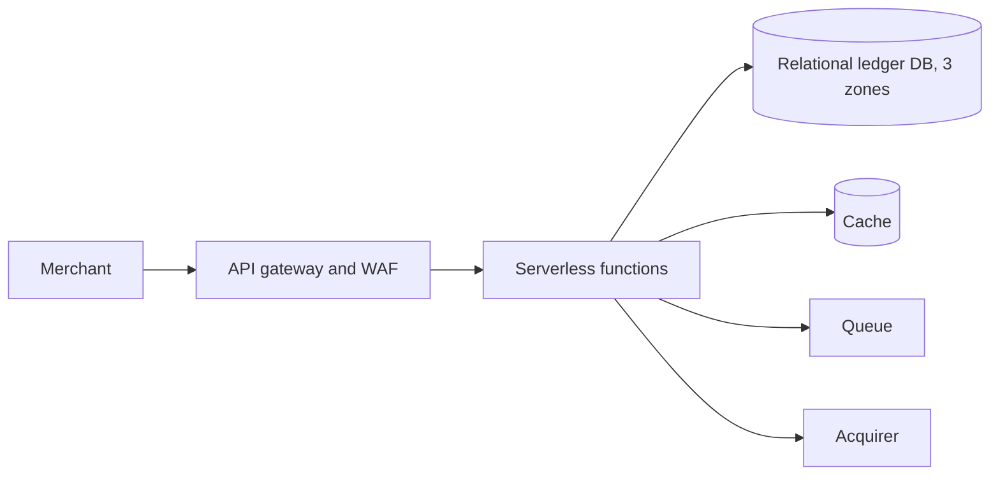
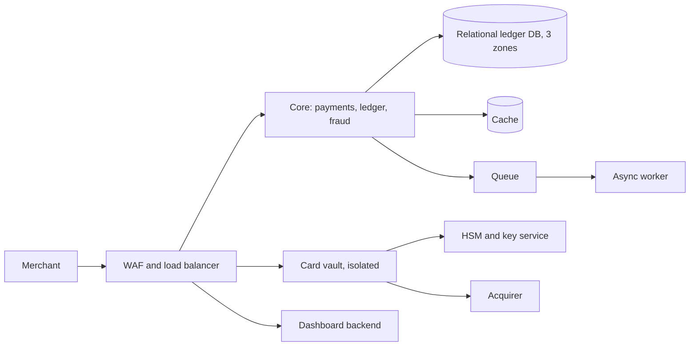
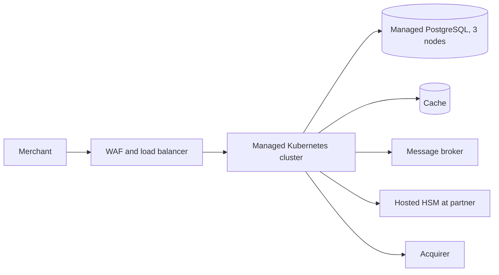

# Options

Three genuinely different options. All keep every customer data store in the EU. Costs are order-of-magnitude estimates for production + disaster recovery + non-production, from memory, with no pricing tool connected. **Rough estimates: verify with each provider's pricing calculator.**

Team-fit scores are in the [README](README.md#team-fit-script-output-verbatim): 4 of 4 for every option, all "Within", all inputs self-reported.

## Neutral building blocks (shared)
- Edge protection (WAF), load balancer, private networking across 3 zones
- Container runtime for: card vault (CDE), core payments + ledger + fraud module, dashboard backend, async worker
- Relational database with synchronous multi-zone replication (ledger)
- In-memory cache (fraud velocity counters, idempotency fast path)
- Managed queue/topic (outbox relay, webhooks)
- Payment HSM / key service
- Managed identity for merchant users, secret store, object storage with write-once lock (audit), observability, registry, CI/CD (hosted, build-time only)

## A. Lowest ops: serverless functions + managed database (AWS)
**Description:** API Gateway plus Lambda (Java with SnapStart or provisioned concurrency) for the payment API and dashboard backend; the same ledger database and the rest of the managed services as B.
**Why each part:** functions remove container operations; gateway handles mTLS/API keys; the ledger still needs a relational ACID database, so serverless only changes compute.
**Trade-offs:**
- Cost shape: pay per call, but Java cold-start mitigation (provisioned concurrency) removes most of the saving at 500 TPS.
- Scalability: concurrency limits and database connection storms at peak; needs a database proxy.
- Portability: lowest. Function and gateway programming models do not move; an exit means rewriting the compute layer, which is hard to defend in a DORA exit plan.
- Latency: cold starts and the gateway hop work against a tight authorisation budget; long-lived connections to acquirers (mTLS, fixed IPs, keep-alive pools) fit poorly.
- Time to first deploy: fast.
- Ops burden: low for compute, same as B for everything else.
**Rough cost:** €9,000-€18,000/month. Drivers: database instances and DR replica, provisioned concurrency, HSM and log ingestion.

## B. Balanced: managed containers + managed data (AWS) — recommended
**Description:** a modular monolith in Kotlin on a managed container runtime across 3 zones, split into only the deployables that a requirement forces: the card vault (isolated PCI scope), the core payments/ledger/fraud service plus async worker, and the dashboard backend. Managed PostgreSQL-compatible database, cache, queue, identity, secrets, HSM service.
**Why each part:** see [ADRs](adr/README.md). In short: containers because that is the team's strength and gives portability; one core service because fraud scoring and ledger writes sit on the same authorisation path and a network hop per payment costs latency and availability; separate vault because it shrinks PCI scope.
**Trade-offs:**
- Cost shape: always-on tasks, predictable.
- Scalability: horizontal for stateless tasks; vertical single writer for the ledger (ceiling noted in README).
- Portability: good, see mapping.
- Time to first deploy: moderate; the PCI and DORA controls, not the platform, set the pace.
- Ops burden: low to medium; no nodes to patch.
**Rough cost:** €10,000-€20,000/month. Drivers: ledger database (writer, two readers, DR replica), always-on tasks in 3 zones, HSM/payment-cryptography, log ingestion and NAT egress.

## C. Most control / most sovereign: EU-headquartered provider + managed Kubernetes
**Description:** the same logical design on a provider headquartered in the EU (for example STACKIT, Germany; IONOS, OVHcloud and Scaleway are alternatives; all product claims here are "(verify)"), on its managed Kubernetes, managed PostgreSQL (verify synchronous replication and RPO 0 semantics), managed Redis and RabbitMQ, a hosted HSM from a partner, and self-run Keycloak for merchant identity.
**Why:** removes the foreign-parent jurisdiction flag entirely (R3) and is the cleanest answer to a sovereignty-minded supervisor.
**Trade-offs:**
- Cost shape: similar or lower infrastructure price; the HSM contract and self-run pieces hide the cost.
- Gaps: no equivalent to a payment-specific cryptography service, so the HSM is a separate contract and integration; identity is self-run; fewer managed services means more of our own on-call; PCI DSS attestation and DORA register entries for a smaller provider need checking (verify).
- Team: Kubernetes at level 1, plus GitOps and self-run identity. The script scores it 4/4 like the others, but I flag it as the least comfortable fit (see README).
- Portability: good (Kubernetes, PostgreSQL, Redis, RabbitMQ are standard).
- Time to first deploy: slowest.
**Rough cost:** €8,000-€18,000/month (high uncertainty). Drivers: database nodes, Kubernetes worker nodes, hosted HSM contract.
**Becomes the right choice when** residency level R3 is required (by BaFin, a key customer, or the CTO), or when the AWS option fails the exit-strategy review.

## Mapping and portability (option B, recommended)
All components in **AWS eu-central-1 (Frankfurt)**, DR pilot light in a second EU region. Availability of each product in each region: verify.

| Component | Product | Portability | What a move takes |
|---|---|---|---|
| Container runtime | ECS on Fargate | Adaptable | Task definitions to Kubernetes or another runtime; images are standard OCI |
| Ledger database | Aurora PostgreSQL (Multi-AZ, Global Database for DR) | Adaptable | Restrict code to standard PostgreSQL; move by logical replication or dump/restore. Global Database is the Locked part (DR only) |
| Cache | ElastiCache for Valkey | Portable | Valkey/Redis protocol is standard |
| Queue and topic | SQS and SNS | Adaptable | Behind an interface; swap to RabbitMQ or similar |
| Merchant identity | Cognito | Adaptable | OIDC standard, but user export and password-hash migration is awkward; keep users and roles in our own tables, not in provider-specific attributes |
| Secrets | Secrets Manager | Adaptable | Apps read through a thin interface; values exportable |
| Keys and payment cryptography | AWS Payment Cryptography plus KMS | **Locked** | Keys can be exported under key-block wrapping only if configured for it; plan for key ceremony into another HSM. See ADR-0004 |
| Network, WAF, load balancer | VPC, WAF, ALB | Adaptable | Concepts exist everywhere; rules are rewritten |
| Acquirer connectivity | Site-to-site VPN, fixed egress IPs | Adaptable | Acquirers must whitelist new IPs; allow lead time |
| Audit archive | S3 with Object Lock | Portable | S3 API is widely supported |
| Observability | CloudWatch, plus OpenTelemetry in the code | Adaptable | Instrument with OpenTelemetry so the backend can change |
| Registry | ECR | Portable | OCI images |
| CI/CD | GitHub Actions (build-time only, no customer data) | Adaptable | Pipelines rewritten; Terraform and images unaffected |
| IaC | Terraform | Portable | |

Equivalent hyperscaler targets in the EU: Azure (Germany West Central) and Google Cloud (europe-west3 Frankfurt) both offer managed containers and PostgreSQL; I chose AWS for the combination of three-zone synchronous storage replication, a payment-specific key service, and Object Lock, not by default (verify each).
