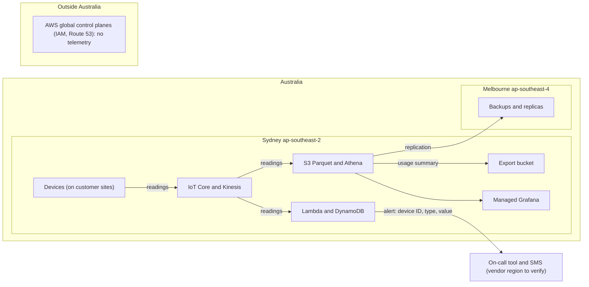

# Data residency and compliance controls

**This is not legal advice.** It is an engineering assessment to support your DPO, legal counsel and auditors.

**These are control requirements for the design, not evidence of compliance; evidence comes from the built system** (configurations, access reviews, test records, audit reports) and the organisation's compliance function.

## 1. Jurisdiction, level and regions
- **Jurisdiction:** Australia (customers and devices).
- **Residency level: R1, in-region** (assumed; only "customers in Australia" was stated). Any provider, regions inside Australia only.
- **Regions:** Sydney `ap-southeast-2` for all processing and storage; Melbourne `ap-southeast-4` for replicated backups only ([ADR-0006](adr/0006-sydney-region-residency.md)). Confirm each service exists in both regions before build (verify).

**Likely applicable (inferred)**
- **Privacy Act 1988 (APP 8 cross-border disclosure, APP 11 security, APP 11.2 destruction of data no longer needed):** applies if telemetry can be linked to an identifiable person or household. Treated as applicable because we assumed device-to-customer linkage.

**Possibly applicable**
- **Notifiable Data Breaches scheme:** if personal information is involved.
- **IRAP / Essential Eight:** if any customer is a government body.
- **Security of Critical Infrastructure Act 2018:** if devices serve energy, water, transport or similar sectors (verify).
- **ISO 27001 / SOC 2:** if customer procurement asks for them.

## 2. Data-flow map

| Data category | Regulated? | Stored in (provider, region) | Processed by | Sub-processors | Leaves Australia? |
|---|---|---|---|---|---|
| Device readings (with device and customer IDs) | Possibly (personal if linked to a person) | AWS ap-southeast-2 (S3, Kinesis, DynamoDB) | IoT Core, Lambda, Firehose, Athena | AWS | No |
| Account and customer mapping | Yes if individuals | AWS ap-southeast-2 | Same | AWS | No |
| Alerts | Low (device ID, type, value only) | SNS and DynamoDB, ap-southeast-2 | Lambda | AWS; on-call tool and SMS carrier if used | Possibly, via the on-call tool (verify vendor region) |
| Logs and metrics | Low (no payloads logged) | CloudWatch, ap-southeast-2 | AWS | AWS | No |
| Backups and replicas | Same as source | S3 and DynamoDB backups, ap-southeast-4 | AWS | AWS | No |
| Finance export | Possibly (customer identifiers) | S3 export bucket, ap-southeast-2 | Athena | AWS | No (finance copies are the company's responsibility) |
| Dashboards | Possibly | Managed Grafana in ap-southeast-2 (verify) | AWS | AWS | No |

## 3. Jurisdiction flags

| Component | Provider | Region | Rating | Mitigation |
|---|---|---|---|---|
| IoT Core, Kinesis, Lambda, DynamoDB, S3, Athena, Firehose, SNS, Grafana | AWS | ap-southeast-2 | 🟡 In-region, foreign parent | US CLOUD Act exposure remains; encrypt with customer-managed KMS keys, restrict regions by SCP, legal assessment is the customer's |
| Backups | AWS | ap-southeast-4 | 🟡 In-region, foreign parent | Same as above |
| IAM, Route 53 (global control planes) | AWS | Global | 🟡 | No telemetry stored; metadata only |
| On-call tool and SMS provider | To be chosen | Unknown | 🔴 until confirmed | Send device IDs only; choose a vendor with Australian processing or accept as documented exposure |
| GitHub (CI) | GitHub | US | 🔴 | No production data or secrets in the repo; deployment through a federated role |

## 4. Provider comparison

| | AWS Sydney and Melbourne (chosen) | Australian-headquartered provider (for example a local cloud or hosting provider; verify) |
|---|---|---|
| Managed device broker, stream and serverless | Available (verify Melbourne coverage) | Check local providers (verify) |
| Gaps | Foreign parent (🟡) | Likely no managed IoT broker, stream, or query engine, so the design would move to Option C |
| Portability | S3 Parquet portable; glue adaptable | Self-run components mostly portable |
| Team-fit verdict | A: Within (3 / 4) | C-style: Within (4 / 4), no headroom |

R3 (Australian-controlled providers only) is not assumed and would push the design to Option C. Only choose it if a customer contract or regulation requires it.

## 5. Control requirements

| ID | Control requirement | Law / framework | Design element |
|---|---|---|---|
| CR-01 | Workloads and data confined to ap-southeast-2 and ap-southeast-4 by SCP | Privacy Act APP 8 | ADR-0006 |
| CR-02 | Encryption at rest with customer-managed KMS keys in the same region; TLS 1.2+ in transit; device certificates per device | APP 11, ISO 27001 | ADR-0001, ADR-0006 |
| CR-03 | Raw data deleted after 400 days (S3 lifecycle); rollups hold no more personal information than needed | APP 11.2 | ADR-0004 |
| CR-04 | Alert messages contain no personal information | APP 8 | ADR-0006 |
| CR-05 | Audit logging (CloudTrail, S3 access logs) retained 12 months at least in ap-southeast-2, access reviewed | ISO 27001, SOC 2 | Process work, enabled by design |
| CR-06 | Backups and restore tested; recovery within 4 h | ISO 27001, SOC 2 | ADR-0007 |
| CR-07 | Per-device certificate revocation for stolen or decommissioned devices | APP 11 | ADR-0001 |
| CR-08 | Third-party vendor register incl. on-call tool, SMS provider, GitHub with data location | APP 8 | Process work |
| CR-09 | Breach detection and notification path to the privacy officer | Notifiable Data Breaches scheme | Process work, enabled by alarms and logs |

The design enables CR-01 to CR-07; CR-08 and CR-09 remain process work.

## 6. Open questions for the DPO, legal and compliance team
1. Is telemetry personal information (can a reading be linked to a person or household)?
2. Is a privacy impact assessment needed?
3. Which on-call and SMS vendors will be used, and where do they process data?
4. Do any customers require IRAP, sovereign controls, or Australian-owned providers?
5. Are any customers in critical-infrastructure sectors (SOCI Act)?
6. Does finance's copy of the export fall under the same retention rules?
7. Is certification (ISO 27001 or SOC 2) planned, and what is its scope?
