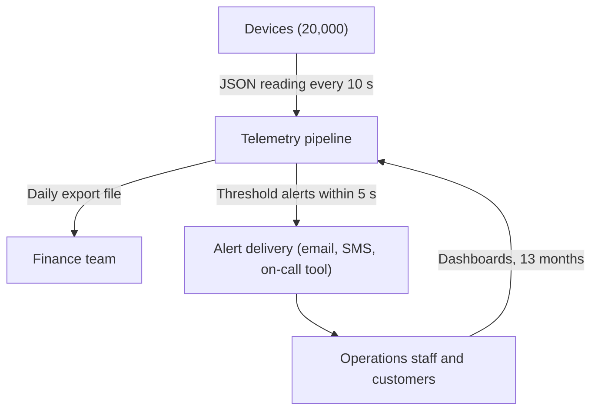
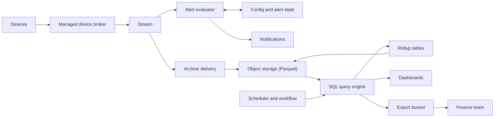
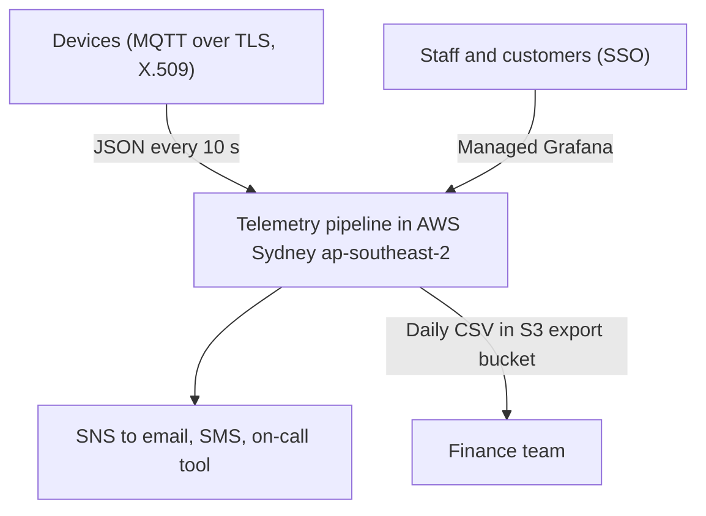
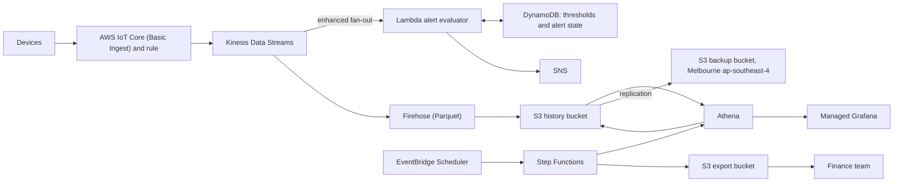
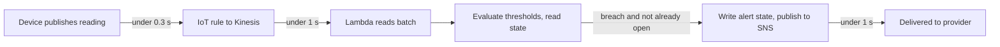

# Diagrams

Option A (recommended). Neutral views first, then the AWS-mapped views.

## C4 context (neutral)

## C4 container view (neutral)

## C4 context (AWS-mapped)

## C4 container view (AWS-mapped)

## Alert flow (sequence of steps)

Latency budget (estimate): publish and rule about 0.3 s, stream and consumer push about 0.5-1 s, evaluation and state write about 0.2 s, SNS handoff about 0.2 s. Expected total about 1.5-2.5 s; the target is p99 under 5 s.
