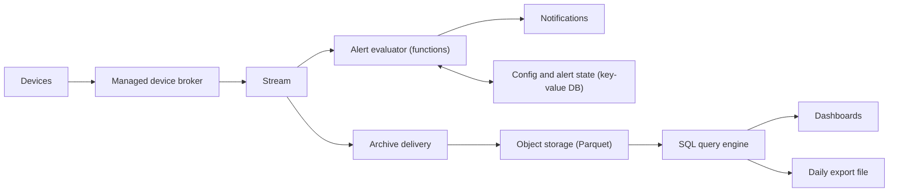
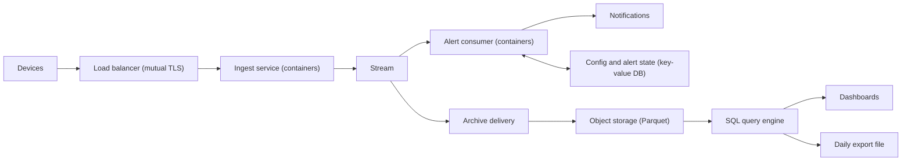
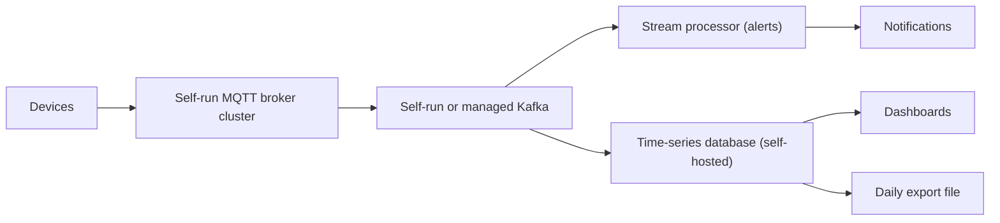

# Options

Sizing basis: 2,000 readings/s, about 300 B each, 5.2 B readings/month, about 67 B rows over 13 months. All costs are USD estimates for ap-southeast-2, from memory (no pricing tool was connected). Rough estimates — verify with each provider's pricing calculator.

Team-fit verdicts are from `plan.py` (budget 4 / 5): A = 3 Within, B = 3 Within, C = 4 Within. All factors are self-reported.

## Shared by all options
- **Archive and history:** Firehose converts to Parquet into S3, partitioned by date. Athena queries it. Scheduled jobs build rollup tables (5-minute, hourly, daily). Reason: 67 B rows is too large for a single relational database on this team's budget, and S3 is cheap and open-format.
- **Dashboards:** Amazon Managed Grafana with the Athena data source. Reason: no servers, SSO, team already knows Grafana-style tooling (assumed).
- **Finance export:** daily scheduled Athena query writes a CSV to a dedicated export bucket, then notifies finance. Reason: the data already sits in S3; no extra service.
- **Identity, secrets, observability, environments:** IAM Identity Center for staff, Secrets Manager (rotation for third-party credentials such as the on-call tool), CloudWatch metrics, logs and alarms, separate production and non-production accounts, CI/CD in GitHub Actions with Terraform.

## Option A: managed device broker and serverless (recommended)
**Description:** devices publish MQTT to AWS IoT Core on Basic Ingest topics. One rule forwards every message to Kinesis Data Streams. A Lambda alert evaluator reads from the stream, compares against thresholds, and publishes alerts to SNS. Firehose reads the same stream for the archive.

| Component | Why needed |
|---|---|
| IoT Core broker (Basic Ingest) | Per-device certificate identity, MQTT termination, and the rule that feeds the stream; nothing of ours to scale or patch |
| Kinesis Data Streams | Buffer and fan-out so alerting and archiving fail independently, and a replay window (24 h to 7 days) |
| Lambda alert evaluator | Stateless threshold check per batch; scales with shards |
| DynamoDB | Thresholds, per-device alert state (open or closed, last-seen) for de-duplication |
| SNS | Delivery to email, SMS and the on-call tool |
| Firehose, S3, Athena, Step Functions, EventBridge Scheduler | Archive, rollups, export orchestration |
| Managed Grafana | Dashboards |

**Trade-offs:** lowest operational burden; time to first deploy about 6-8 weeks (estimate). Per-message pricing means cost scales linearly with device count and reporting rate. Rule logic lives in Lambda code, not the IoT rules engine, so it can be unit-tested.
**Rough cost:** $3,000-5,000 per month. Drivers: IoT Core rule plus action fees (about $0.30 per million messages, so about $1,600/month), Lambda and Kinesis consumers ($400-1,000), Athena/S3/Firehose ($300-800), Grafana, logs and DynamoDB ($300-800).

## Option B: own ingest service on managed containers
**Description:** devices send over HTTPS or MQTT-over-TLS to a Go ingest service on ECS Fargate behind a load balancer, authenticated with mutual TLS against our own private CA. The service validates and writes to Kinesis. The alert consumer is a second Go service on Fargate. The rest is the same as A.

**Trade-offs:** works with devices that only speak HTTPS; full control of validation and payload; no per-message broker fee. But the team owns a certificate authority and device certificate lifecycle for 20,000 devices (issuance, rotation, revocation), two always-on services needing at least 3 zones' worth of tasks, rolling deploys without dropping connections, and ingest scaling during reconnect storms. Time to first deploy about 8-10 weeks (estimate).
**Rough cost:** $2,500-4,500 per month. Drivers: ALB and Fargate tasks sized for bursts ($600-1,400), private CA fees (a fixed monthly fee plus per-certificate charges, verify), shared data tier as A.
**Lower cost does not materialise:** the saving over A is within the error of the estimates, and it buys more on-call surface.

## Option C: self-run broker, Kafka and time-series database
**Description:** an MQTT broker cluster (for example EMQX) on EC2 or ECS, Kafka (MSK), Flink for alert stream processing, TimescaleDB for 13-month history, Prometheus and Grafana for observability.

**Trade-offs:** full control, best raw-query latency for dashboards, portable to any cloud. Costs: four stateful or complex systems to patch, upgrade, size and restore; stream processing and a self-hosted database are weight-3 and weight-4 components. Time to first deploy 14+ weeks (estimate). `plan.py` calls it Within at 4 / 4, but that leaves no headroom, and nothing in the requirements needs this control.
**Rough cost:** $3,500-7,000 per month. Drivers: always-on multi-AZ broker and database nodes, MSK brokers, replicated storage for 13 months of raw data.

## Mapping to AWS (Option A) with portability

| Capability | Product (ap-southeast-2) | Portability |
|---|---|---|
| Device broker | AWS IoT Core, Basic Ingest | **Adaptable.** MQTT and X.509 are standard, so devices keep working against another broker; the registry, certificates and rule would need migrating and a CA taking over |
| Ingest stream | Kinesis Data Streams | **Adaptable.** Kafka-compatible alternatives exist; producer and consumer code needs changing |
| Alert evaluator | Lambda (Go or Python) | **Adaptable.** Business logic is plain code behind a small handler, movable to containers |
| Config and alert state | DynamoDB | **Locked.** Small, simple key-value data, so migrating to PostgreSQL is a short job, but the access code is DynamoDB-specific |
| Notifications | SNS | **Adaptable.** Topic fan-out replaceable by any queue or webhook |
| Archive delivery | Kinesis Data Firehose | **Adaptable.** Replaceable by a small consumer writing Parquet |
| History | S3, Parquet (Iceberg tables optional) | **Portable.** Open file format, S3 API widely implemented |
| Query | Athena | **Adaptable.** Trino/Presto SQL; Iceberg tables open it to other engines |
| Orchestration | Step Functions | **Locked.** State machines are AWS-specific; flows are short (rollup, export), cheap to rewrite |
| Scheduling | EventBridge Scheduler | **Adaptable.** Cron semantics only |
| Dashboards | Amazon Managed Grafana | **Portable.** Dashboards are Grafana JSON; self-hosted Grafana can import them |
| Secrets | Secrets Manager | **Adaptable.** Standard secret-store pattern |
| Observability | CloudWatch | **Adaptable.** Metrics and alarms are re-createable; custom metrics names should be kept in code |
| CI/CD | GitHub Actions | **Portable.** Workflows are standard YAML around Terraform and tests |

Overall lock-in for A: **Medium**. The data (S3 Parquet) and the devices' protocol are portable; the glue is AWS-specific but small. Regional availability of each service in ap-southeast-2 and ap-southeast-4 should be verified before build (notably IoT Core, Managed Grafana and Firehose in Melbourne).
