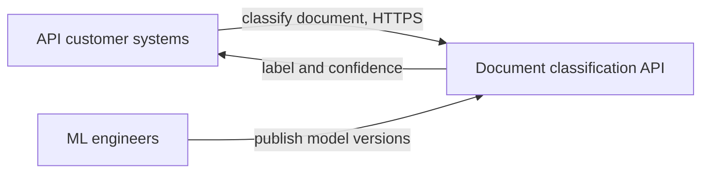
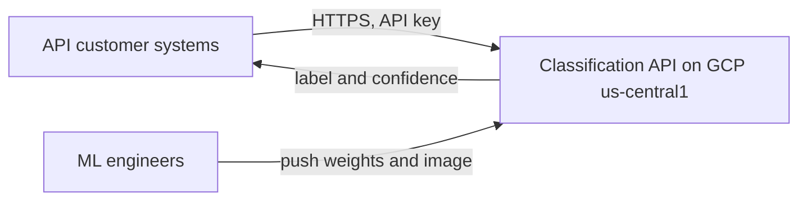
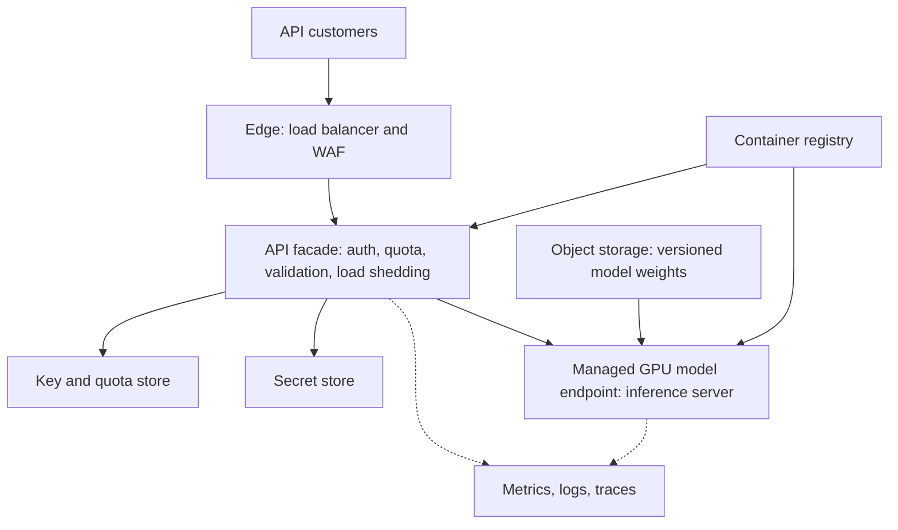
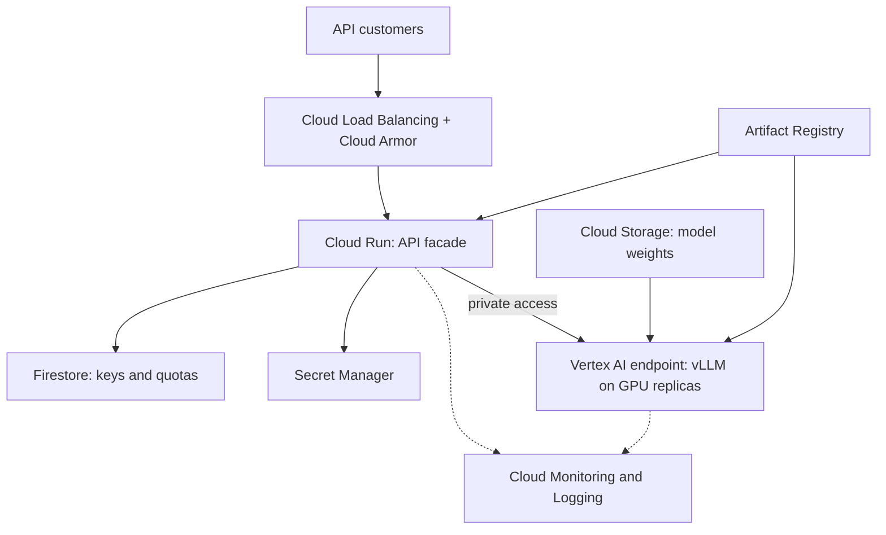
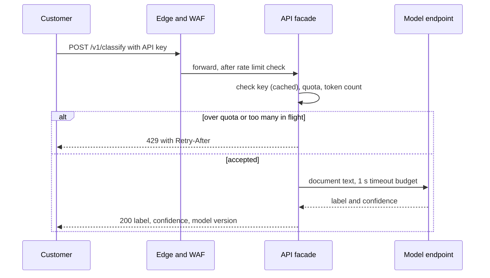

# Diagrams: ML inference API (recommended option A)

## 1. System context (neutral)

## 2. System context (mapped to GCP)

## 3. Containers (neutral)

## 4. Containers (mapped to GCP)

## 5. Request flow

