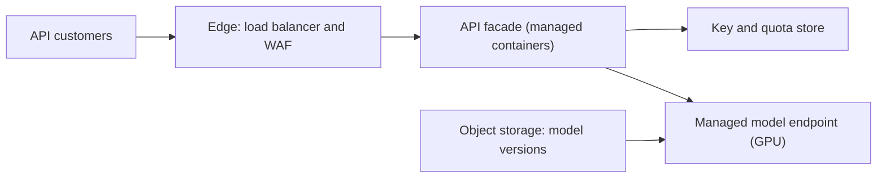
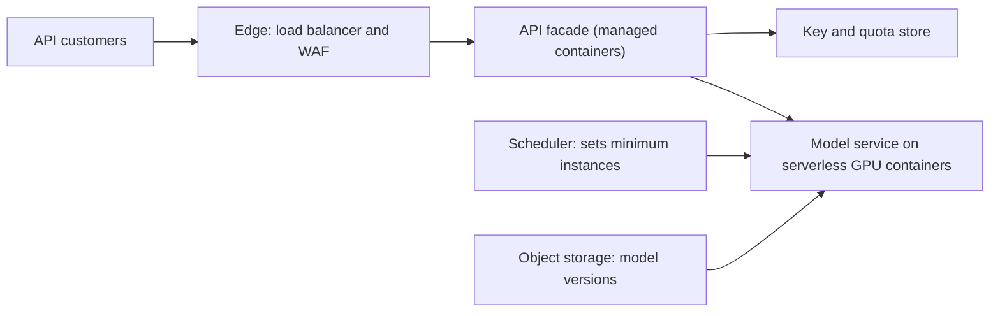
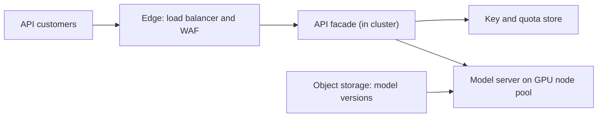

# Options: ML inference API

All three options share the same front half: load balancer with WAF, a thin API facade, a key and quota store, managed secrets, managed observability, object storage for model artifacts. They differ in **how the GPU model server is run**. Assumptions are in [README.md](README.md).

Sizing basis (assumed): 50 req/s × about 1,000 tokens ≈ 50k tokens/s of prefill at peak. The number of GPUs depends on measured tokens/s per GPU, which is not yet known. Assume a roughly 60% target utilisation for headroom.

## Option A. Managed ML endpoint (lowest ops) ★ recommended
**Description:** The model server container (vLLM) is deployed to a managed model-serving endpoint. The provider runs the GPU machines, health checks, replacement and autoscaling between a minimum and maximum replica count. The facade calls it privately.

**Components and why:** Facade on managed containers (auth, quotas, validation, load shedding). Managed model endpoint (GPUs without owning nodes). WAF (public endpoint needs rate limiting and abuse protection). Document store for API keys (tiny, serverless). Object storage (versioned weights). Secrets, registry, observability, CI/CD (needed baseline).

**Trade-offs:**
- Cost shape: GPU replicas are billed while deployed; minimum replicas run overnight and weekends (no scale-to-zero).
- Scalability: autoscaling reacts in minutes; headroom has to be pre-provisioned.
- Portability: container is portable; the endpoint wrapper is Adaptable.
- Time to first deploy: shortest, about 4-6 weeks (estimate).
- Ops burden: low. Provider handles nodes.

**Rough cost:** $4k-12k/month. Drivers: GPU type and replica-hours, overnight minimum replicas, document length. Rough estimates — verify with each provider's pricing calculator.

## Option B. Serverless GPU containers (balanced)
**Description:** The same model container runs on a serverless container platform that supports GPUs. It scales on concurrent requests and can scale to zero. A scheduler raises the minimum instance count before business hours and lowers it after.

**Components and why:** As A, but the model runs as a second serverless container service, plus a scheduled job that sets minimum instances (because a GPU instance takes minutes to load 16 GB of weights and cannot cold-start inside a 1.5 s request).

**Trade-offs:**
- Cost shape: lowest overnight cost (can scale to zero).
- Scalability: limited GPU choice (L4-class only, verify), so more instances for the same throughput; per-region GPU quota applies.
- Portability: Portable (any container platform).
- Time to first deploy: about 4-6 weeks (estimate).
- Ops burden: low to medium. The team owns the capacity schedule; a bad schedule means cold starts hitting users. Rated **At limit** by the team-fit check; mitigation is a managed scheduler and the same container as A.

**Rough cost:** $3k-9k/month. Drivers: GPU-hours (scale-down off-hours), L4 count needed at peak, document length. Rough estimates — verify with each provider's pricing calculator.

## Option C. Kubernetes GPU serving (most control)
**Description:** A managed Kubernetes cluster with GPU node pools runs vLLM, with an inference-serving layer on top.

**Components and why:** Managed Kubernetes plus self-run GPU serving: most flexible, with the best GPU utilisation tuning (batching, multi-model on one GPU).

**Trade-offs:**
- Cost shape: GPU node-hours plus idle headroom; best price per token if tuned well.
- Portability: Portable (Kubernetes and vLLM), highest of the three.
- Time to first deploy: slowest, about 8-12 weeks (estimate), because the team has no Kubernetes experience.
- Ops burden: high. Node upgrades, GPU drivers, quotas, autoscaler tuning, with no one on call. The check says **At limit**; I rate it **rejected for now** (see README).

**Rough cost:** $3k-9k/month plus cluster fee. Drivers: GPU node-hours, idle capacity, node-pool minimums. Rough estimates — verify with each provider's pricing calculator.

**Become right when:** the team has a Kubernetes-skilled engineer or platform team, runs several models, or must be portable across clouds.

## Mapping (recommended option A, GCP us-central1)
| Component | Product | Portability | What moving would take |
|---|---|---|---|
| Edge protection | Cloud Load Balancing + Cloud Armor | Adaptable | Equivalent LB/WAF on another cloud; rules rewritten |
| API facade | Cloud Run | Portable | Any OCI container platform |
| Model serving | Vertex AI endpoint with custom vLLM container | Adaptable | Same container on Cloud Run GPU, GKE or another cloud's endpoint; deployment config rewritten |
| API keys and quotas | Firestore | Adaptable | Small schema; port to any document or SQL store; one data-access module |
| Model artifacts | Cloud Storage (multi-region US) | Portable | Standard HF weights format; copy to any object store |
| Secrets | Secret Manager | Adaptable | Equivalent secret store; the app reads via one interface |
| Observability | Cloud Monitoring and Logging | Adaptable | Dashboards and alert rules rebuilt; logs are structured JSON |
| Images | Artifact Registry | Portable | OCI images |
| CI/CD | Cloud Build | Adaptable | Build steps are container commands; pipeline definition rewritten |

Verify before committing: the GPU types and per-endpoint limits (payload size, request timeout, minimum replicas) of the managed endpoint in us-central1; that Cloud Run GPU is offered in the chosen region (for B); and current GPU quota defaults.
