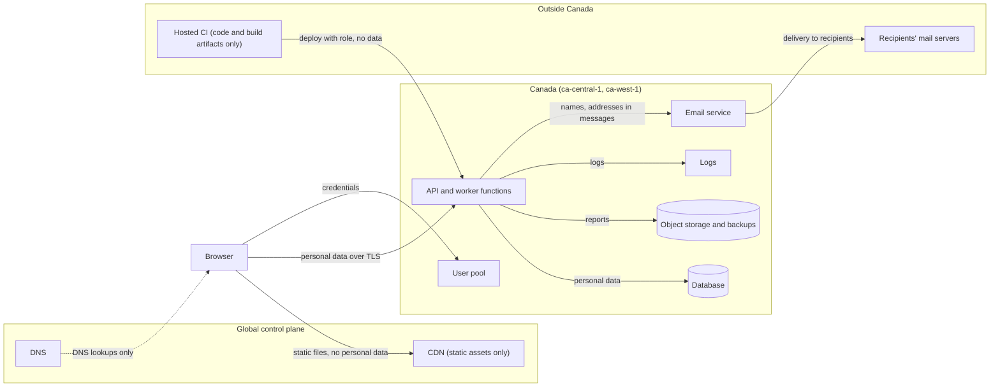

# Residency and compliance controls

**This is not legal advice.** It is an engineering assessment to support your legal counsel, privacy officer and auditors.

**These are control requirements for the design, not evidence of compliance; evidence comes from the built system.** Evidence (configurations, access reviews, test records, audit reports) comes from the built system and the organisation's compliance function.

## 1. Jurisdictions, residency level and regions

- **Jurisdictions:** Canada and the United States (customers); data hosted in Canada.
- **Residency level: R1 (in-region)**, assumed because only countries were named. Any provider, regions inside Canada only for primary data and backups.
- **Likely applicable (inferred):**
  - PIPEDA (Canada): customers' employees and end-customers' addresses are personal data.
  - Provincial privacy laws, for example Quebec Law 25: if customers are in Quebec (privacy impact assessment before data leaves Quebec (verify details)).
  - SOC 2: B2B buyers, mainly US, ask for it in procurement.
- **Possibly applicable:**
  - US state privacy laws (e.g. CCPA/CPRA): depends on company size and whether US individuals' data is held as a business or as a service provider.
  - CASL (Canada's anti-spam law): only if marketing email is added; transactional messages are mostly outside it (verify).
  - ISO 27001: if EU or global buyers ask.
  - Public-sector Canadian customers may require Canadian-only storage (verify per customer).
- **Not applicable by assumption:** HIPAA, PCI DSS, FedRAMP.

| Data category | Region |
|---|---|
| Account, schedule, job and customer-address data | `ca-central-1` |
| Backups | `ca-central-1`, copy in `ca-west-1` |
| Logs and metrics | `ca-central-1` (1-year retention; personal data minimised) |
| Reports | `ca-central-1` (copy in `ca-west-1`) |

## 2. Data-flow map

| Data category | Regulated? | Stored in (provider, region) | Processed by | Sub-processors | Leaves the jurisdiction? |
|---|---|---|---|---|---|
| Account/profile (names, emails, roles) | Yes (PIPEDA) | AWS `ca-central-1` (database, user pool) | API and worker functions | AWS (Cognito) | No |
| Customer service addresses, jobs, schedules | Yes | AWS `ca-central-1` | API and worker functions | AWS; geocoding service (Amazon Location Service, verify) | No |
| Special or sensitive data | None assumed | n/a | n/a | n/a | n/a |
| Payment card data | None (no payments) | n/a | n/a | n/a | n/a |
| Logs/telemetry | Yes (may contain identifiers) | AWS `ca-central-1` | CloudWatch | AWS | No |
| Backups | Yes | AWS `ca-central-1`, `ca-west-1` | RDS, S3 | AWS | No |
| Report files | Yes | AWS `ca-central-1` | Worker function | AWS | No (recipient downloads leave by design) |
| Email content | Yes | Not stored beyond the send log | SES `ca-central-1` | AWS | Recipients' mail servers are outside our control |
| Analytics | None in year one | n/a | n/a | n/a | n/a |
| AI prompts/embeddings | None | n/a | n/a | n/a | n/a |

## 3. Jurisdiction table

| Component | Provider | Region | Rating | Mitigation |
|---|---|---|---|---|
| Database, queue, object storage, functions, secrets, logs | AWS | `ca-central-1` | 🟡 In-region, foreign parent (US CLOUD Act) | Customer-managed keys; encrypt at rest and in transit; contractual terms; documented in customer-facing sub-processor list |
| Backup copies | AWS | `ca-west-1` | 🟡 | Same; in Canada |
| User pool | AWS Cognito | `ca-central-1` | 🟡 | Same; confirm user-pool data region (verify) |
| Email | AWS SES | `ca-central-1` | 🟡 | Minimal personal data in messages; links instead of attachments |
| Static site + CDN | AWS CloudFront | Global edge | 🟡 | Static assets only; no personal data; API is not behind the CDN |
| DNS | AWS Route 53 | Global | 🟡 | Only domain names; no personal data |
| Geocoding | Amazon Location Service | `ca-central-1` (verify availability) | 🟡 | If unavailable, send address text only to a vetted vendor; otherwise it is 🔴 and needs a transfer decision |
| CI/CD | GitHub Actions | United States | 🔴 | No production data or secrets with data access in CI; deploy by short-lived role; use synthetic data in tests |
| Error tracking / APM | None (CloudWatch only) | n/a | n/a | Deliberately avoided to keep personal data in Canada |

## 4. Provider comparison

| | AWS (`ca-central-1`, `ca-west-1`) | Azure (Canada Central/East) | GCP (Montréal, Toronto) | Canadian-headquartered provider (R3) |
|---|---|---|---|---|
| In-region managed services needed | All present (verify per service) | Equivalent services exist | Equivalent services exist | Check local providers (verify); managed database and queue coverage is uncertain |
| Rating | 🟡 | 🟡 | 🟡 | 🟢 if one is chosen |
| Team fit | Within (script) | Not scored; no team experience stated | Not scored | Likely Exceeds: more self-run components |
| Portability | Mixed (see options.md) | Mixed | Mixed | Depends |

AWS is chosen because the team has some experience with it. An R3 requirement (Canadian-only provider) is not assumed; if it appears, reclassify components as self-hosted and rerun the team-fit check.

## 5. Laws and frameworks → control requirements

| ID | Control requirement | Law / framework | Design element |
|---|---|---|---|
| CR-01 | Primary data and backups only in `ca-central-1` and `ca-west-1`; region-restricting policy | PIPEDA, Quebec Law 25, customer contracts | [ADR-0002](adr/0002-canadian-region-residency.md) |
| CR-02 | Encryption at rest with customer-managed keys; TLS 1.2 or higher in transit | PIPEDA safeguards, SOC 2 | ADR-0002, ADR-0007 |
| CR-03 | Tenant isolation enforced in the database and tested | SOC 2, customer contracts | [ADR-0003](adr/0003-shared-database-row-level-security.md) |
| CR-04 | Audit log of privileged access and admin actions, retained 1 year | SOC 2, PIPEDA accountability | ADR-0003 |
| CR-05 | Export and delete one company's or one person's data within 30 days | PIPEDA access and withdrawal rights, Law 25, CCPA (if applicable) | ADR-0003 |
| CR-06 | MFA for dispatchers, admins and all staff with production access | SOC 2 | [ADR-0006](adr/0006-managed-auth-user-pool.md) |
| CR-07 | Change management: pull-request review and pipeline deployment; separate production account; no console changes | SOC 2 | README (environments, CI/CD) |
| CR-08 | Backups with point-in-time recovery and a recorded restore test | SOC 2 availability | [ADR-0007](adr/0007-backup-and-recovery.md) |
| CR-09 | Sub-processor list maintained; no personal data in third-party telemetry or CI | PIPEDA accountability, customer contracts | ADR-0002 |
| CR-10 | Logs and alarms sufficient to detect and assess a breach, to support reporting of breaches with a real risk of significant harm (verify deadlines and thresholds) | PIPEDA breach reporting, Law 25 | README (observability) |

**What the design enables vs. process work:** the technical controls above are enabled by the design. SOC 2 is an audit of the organisation: policies, access reviews, vendor management, incident response, restore tests and evidence collection remain process work for the company.

## 6. Open questions for legal and compliance

1. Do any customers require Canadian-only or US-only storage in their contracts? Are any public-sector?
2. Are there Quebec customers, and does Law 25 require a privacy impact assessment before onboarding them?
3. Is a data processing agreement and sub-processor list needed in customer contracts?
4. Which SOC 2 scope (Type I or II) and timeline do enterprise prospects expect?
5. Does the geocoding provider need its own transfer assessment?
6. What are the breach-notification deadlines and thresholds the company must meet in each province and state of operation?
7. Is any technician data (for example location tracking) treated as employee personal information, and does that change consent requirements?
