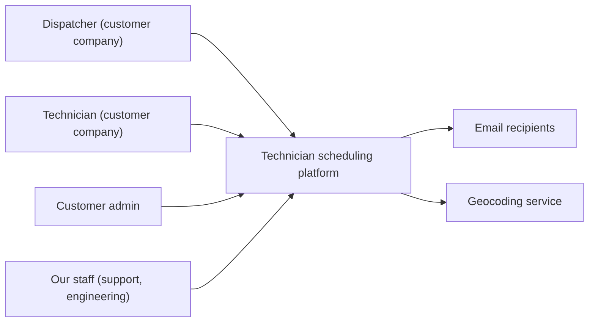
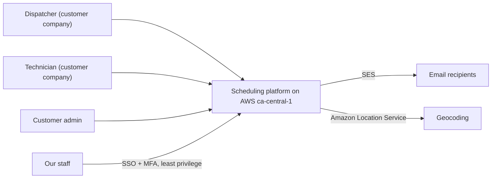
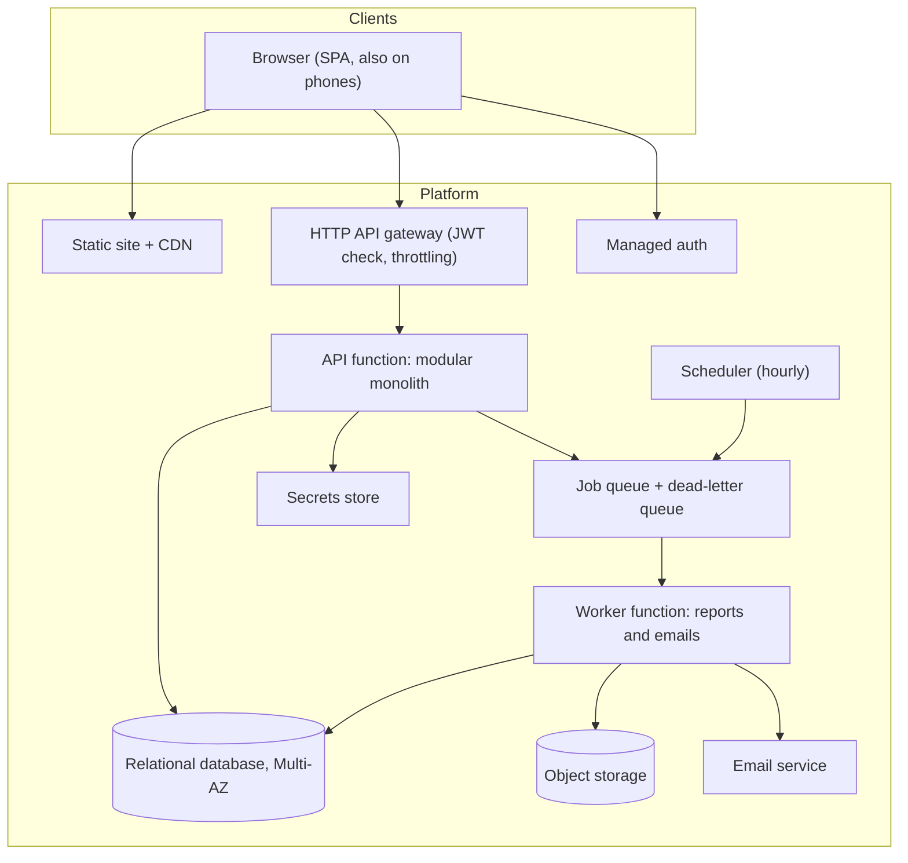
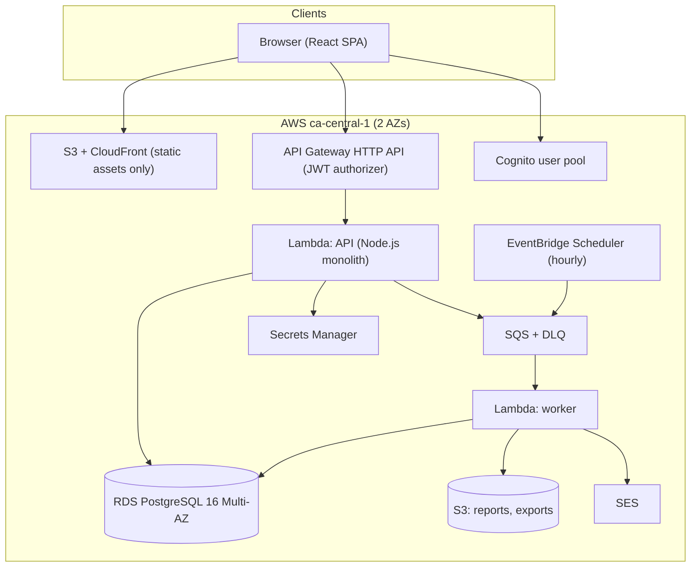
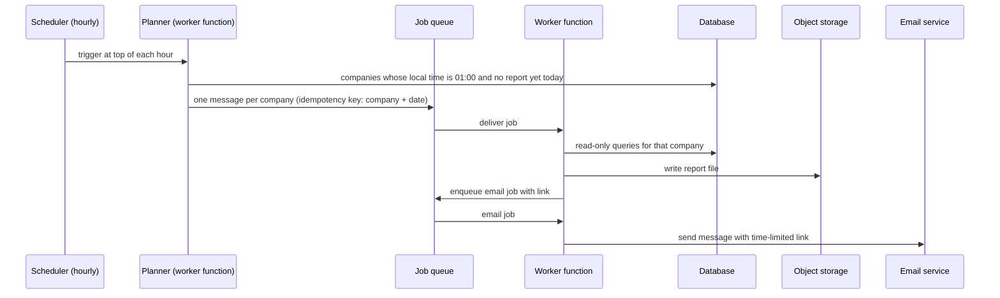
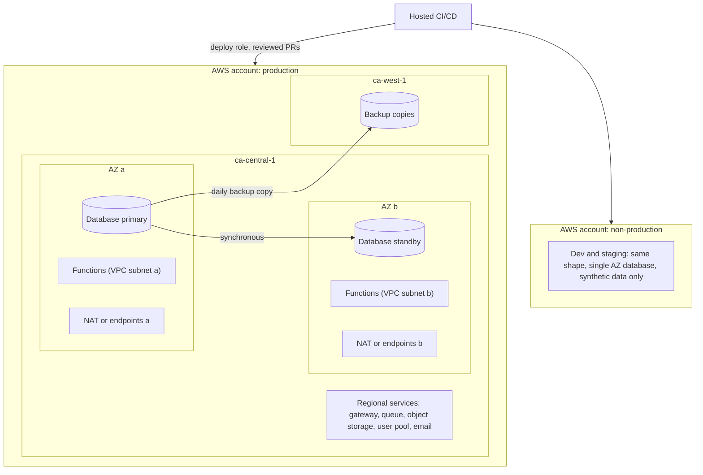

# Diagrams

Each view appears first in neutral terms, then mapped to the recommended Option A on AWS `ca-central-1`.

## 1. System context

### Neutral

### Mapped (AWS)

## 2. Container view

### Neutral

### Mapped (AWS)

## 3. Nightly report flow

## 4. Deployment view

Two NAT gateways or two sets of interface endpoints (one per AZ) avoid a single NAT being a single point of failure on the API path.
