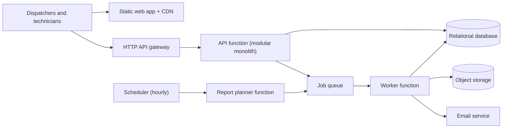
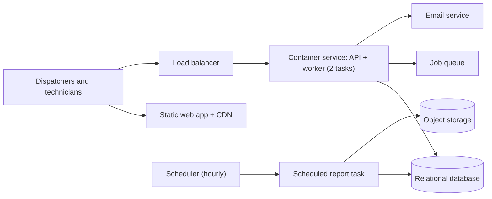
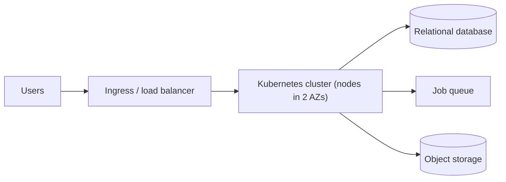

# Options

All three options use AWS `ca-central-1` (see [ADR-0002](adr/0002-canadian-region-residency.md)) and PostgreSQL. They differ in how application code runs. Cost figures are rough monthly USD estimates, not quotes.

## Option A. Lowest ops: serverless functions + managed data (recommended)

One modular TypeScript monolith deployed as an API function and a worker function from the same codebase. No servers or containers to patch.

| Component | Why it is needed |
|---|---|
| Static site + CDN | Serves the web app; no servers |
| HTTP API gateway | TLS, throttling, JWT authorisation, routing to the function |
| API function (modular monolith) | All REST endpoints, one deployable |
| Worker function | Processes queue jobs: reports and emails |
| Scheduler | Hourly trigger for the nightly report sweep |
| Queue (+ dead-letter queue) | Fans out one job per company; decouples email sending; retries |
| Relational database, Multi-AZ | Scheduling data needs transactions and constraints (no double-booking) |
| Object storage | Generated reports, exports, backups |
| Managed auth | Users, passwords, MFA, tokens |
| Email service | Transactional email |
| Secrets store | Database credentials, rotation |
| Logging and metrics | Structured logs, alarms, dashboards |
| CI/CD (hosted) | Build, test, deploy; not a runtime component |

- **Trade-offs:** Lowest operations; pay per use; scales to zero outside business hours except the database. Cold starts; 15-minute function limit; database connections need care; some AWS-specific wiring.
- **Cost: $300-600/month.** Drivers: Multi-AZ database ($150-250 with storage), network path for functions inside a VPC (two NAT gateways or interface endpoints, $50-130), logs ($20-60). Function and API gateway charges at this load are small ($30-80).
- **Time to first deploy:** shortest; no image build or cluster wiring.
- **Portability:** the application is a standard HTTP app behind a Lambda adapter, and the data is plain PostgreSQL.

## Option B. Balanced: managed containers + managed data

The same monolith as one container image, run as a long-lived service plus a scheduled task for reports.

Components: as A, except the API and worker run as a **managed container service** (2 tasks across 2 AZs) behind a **load balancer**, the nightly report is a **scheduled container task** (no 15-minute limit), and a **container registry** holds images.

- **Trade-offs:** No cold starts, no time limit for reports, normal long-lived database connections, easy local parity. But always-on cost, a load balancer, image patching (base image updates), container networking, and one more skill to learn. This is why the script rates it At limit.
- **Cost: $350-700/month.** Drivers: always-on tasks ($70-150), load balancer ($25-40), NAT or endpoints in 2 AZs, database as in A.
- **Time to first deploy:** a little longer than A (registry, service, load balancer, task definitions).
- **Portability:** high; container images run anywhere.

## Option C. Most control: managed Kubernetes

Included for completeness: the same monolith on a managed Kubernetes cluster.

- **Trade-offs:** Maximum control and portability across clouds. For this team, it adds cluster upgrades, node patching, ingress, autoscaling and cluster security with no one on call and no Kubernetes experience. No requirement here (multi-cloud, many services, special hardware) calls for it.
- **Cost: $600-1,200+/month.** Drivers: control-plane fee (about $73), always-on worker nodes in 2 AZs, then the same database and network path as B.
- **Verdict:** Exceeds in practice (see README note on the script's score). Becomes right only if the team grows a platform function, or a customer or product requirement forces multi-cloud or a many-service architecture.

*Rough estimates, verify with each provider's pricing calculator.*

## Comparison

| | A. Serverless | B. Managed containers | C. Kubernetes |
|---|---|---|---|
| Team-fit verdict (script) | Within (2) | At limit (3) | At limit (3); Exceeds in practice |
| Rough cost / month | $300-600 | $350-700 | $600-1,200+ |
| Patching burden | None (managed runtime) | Base image updates | Nodes, cluster, images |
| Report time limit | 15 min per job | None | None |
| Cold starts | Yes | No | No |
| Lock-in | Medium (adapter and wiring only) | Low | Low |

## Provider mapping and portability (Option A, `ca-central-1`)

| Capability | Product | Portability | What a move would take |
|---|---|---|---|
| Static site + CDN | S3 + CloudFront | Portable | Any object store and CDN; copy files |
| HTTP API gateway | API Gateway (HTTP API) | Adaptable | Replace with another gateway or a load balancer; routes are defined in one place |
| API and worker functions | Lambda (Node.js, one codebase) | Adaptable | App is a standard HTTP framework with a thin adapter; repackage as a container (Option B) |
| Scheduler | EventBridge Scheduler | Adaptable | Any cron trigger calling the planner entry point |
| Queue + DLQ | SQS | Adaptable | Another queue; consumer code isolated behind a small interface |
| Relational database | RDS for PostgreSQL 16, Multi-AZ | Portable | Standard PostgreSQL dump and restore, or logical replication |
| Object storage | S3 | Portable | S3-compatible API is common |
| Managed auth | Cognito user pool | Adaptable | OIDC tokens are standard; users migrate with a forced password reset (hashes can't be exported) |
| Email | SES | Adaptable | SMTP or another provider API; domain DNS records transfer |
| Geocoding | Amazon Location Service (verify availability and terms in `ca-central-1`) | Adaptable | Any geocoder behind one internal interface |
| Secrets | Secrets Manager | Adaptable | Another vault; read through one config module |
| Logs and metrics | CloudWatch | Adaptable | Export logs; alarms rebuilt elsewhere |
| DNS | Route 53 | Portable | Zone export |
| CI/CD | GitHub Actions | Adaptable | Workflow files are CI-specific; build scripts are plain npm scripts |
| Infrastructure definition | An IaC tool of the team's choice | Portable | Depends on the tool; keep it in one repository |
