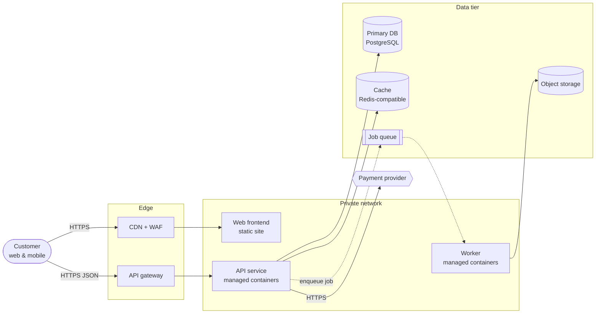

# Architecture diagrams (Mermaid)

Mermaid renders in GitHub, GitLab, most wikis and Claude, and diffs cleanly in
git — so it is the default. Produce **text diagrams only**; never reproduce
vendor icon artwork.

**No repository or project folder (e.g. Claude chat, Cowork).** If there is
no repository or writable project folder available (for example in Claude chat
or Cowork without a folder), do not try to write files: deliver every document
in the conversation as Markdown sections with the same headings, and say once
that files weren't written. Skip repo scanning and say the team profile is
self-reported.

## Views to produce
Write them all to `diagrams.md`, each under its own heading with a one-line
caption explaining what to look at.

1. **System context (C4 L1)** — the system as one box, its users and external
   systems. Use `flowchart LR`.
2. **Containers (C4 L2), neutral** — runtime components named by capability
   (e.g. "API service — managed containers", "Primary DB — PostgreSQL").
3. **Containers (C4 L2), mapped** — same layout, labelled with the chosen
   provider's products: `API service (Cloud Run)`.
4. **Deployment view** — network boundaries: public edge, private network,
   data tier, regions/zones, environments if relevant. Use `subgraph`s.
5. **Key flow** — one `sequenceDiagram` for the most important request path
   (e.g. checkout, upload-and-process), including async hops.

## Conventions
- `flowchart LR` for context/containers, `flowchart TB` for deployment.
- Node IDs in snake_case; labels in plain words, ` ` for a second line
  with the technology.
- Shapes: `[( )]` databases and storage, `[[ ]]` queues/streams, `([ ])`
  people/actors, `[ ]` services, `{{ }}` external systems.
- Edge labels say what flows and how: `-->|HTTPS JSON|`, `-.->|async event|`.
  Dotted arrows for async.
- Use `subgraph` for trust boundaries: Internet, Edge, Private network,
  Data tier, Third parties.
- Keep each diagram to ~15 nodes. Split rather than cram.
- Mark provider-locked components with ` 🔒` at the end of the label only in the
  mapped view, and add a legend line under the diagram.
- Wrap any label containing `()`, `[]` or `{}` in double quotes:
  `api["API service (Cloud Run)"]`. Never use `end` as a node id.

## Check before finishing (required)
Go through every Mermaid block in the files you wrote (or in your reply) and fix
anything that fails before telling the user the diagrams are ready:

1. The first line is a diagram type: `flowchart LR` / `flowchart TB`,
   `sequenceDiagram`, `C4Context`, `C4Container` or `C4Deployment`.
2. Every label containing `()`, `[]`, `{}`, `:` or `#` is in double quotes:
   `api["API service (Cloud Run)"]`.
3. Brackets and quotes are balanced on every line; shapes open and close with
   the same bracket type.
4. Every `subgraph` has a matching `end`, and no node id is `end`, `graph` or
   `subgraph`.
5. Arrows use valid syntax (`-->`, `-.->`, `==>`, `-->|label|`); in sequence
   diagrams every participant used is declared or first appears in a message.
6. Node ids are letters, digits and underscores only, unique per diagram.
7. About 15 nodes or fewer; split larger diagrams.

This is a self-check, not a renderer: keep diagrams simple. If the user can't
render them, say they weren't machine-checked.

## Example (neutral container view)

## Optional formats
If the user asks for something else, offer:
- **Structurizr DSL** — for teams who maintain a C4 model long term.
- **D2** — nicer automatic layouts.
- **draw.io XML** — for editing in diagrams.net; use plain shapes and labels.
State that provider icon sets can be applied in those tools by the user.
